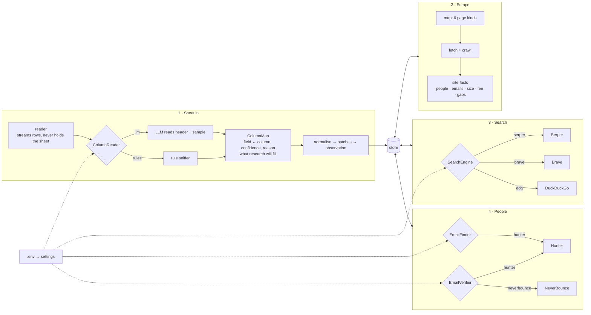

# Plan v2 — crack scraping, search and LinkedIn first

**Set on 17 Sep 2026.** Supersedes the *sequencing* in `../PLAN.md`; the scope there (acquisition, qualification, pain, drafted journey; no sending) still stands.

## The reframing

Most of this project is scraping. If the site is read properly, the web is searched properly, and the person's LinkedIn profile is found, the job is ninety percent done. Everything downstream — tiering, drafting, hooks — is refinement of data that has to exist first. The build so far did the opposite: it went deep on tiering, journey copy and screens while the three upstream steps stayed weak. This plan fixes the order.

Nothing here is built until the plan is agreed. Each workstream has a deliverable that can be checked on the 242-firm probe before it runs over the full 22,182.

## Architecture — the seams between the chunks

The chunks connect through the store and through four *seams*: small interfaces with interchangeable implementations, each chosen by one `.env` key in `lge/settings.py`. No component names a provider; it asks the seam. That is what makes a provider swappable without touching the chunk that uses it.

| Seam | Where | Implementations | Chosen by |
|---|---|---|---|
| `ColumnReader` | `lge/ingest/columns.py` | `llm` (OpenRouter, one call per sheet, validated by the rule sniffer), `rules` | `LGE_COLUMN_READER` = `auto` (llm when a key exists) / `llm` / `rules` |
| `SearchEngine` | `lge/search/` | `serper`, `brave`, `ddg` | `LGE_SEARCH_ENGINE` = `auto` (first key found) / a name |
| `EmailFinder` | `lge/enrich/` | `hunter` | `LGE_EMAIL_FINDER` |
| `EmailVerifier` | `lge/enrich/` | `hunter`, `neverbounce` | `LGE_EMAIL_VERIFIER` |
| firm size sources | `config/precedence.yml` | LLM team-page reading, the site's own staff count, LinkedIn headcount, the sheet | precedence order, not code |

Rules that hold across every chunk:

- **A field a sheet lacks is research-fillable, never fatal.** The only hard requirement is a firm name plus a way to reach the firm (website, email, or a location).
- **Rows stream.** Nothing reads a whole sheet into memory; batches are read as they load, so 100,000 rows cost the same per row as 100.
- **Every output of a chunk is a row in the store** (observation, claim, contact, search_log). The next chunk reads the store, never the previous chunk's objects.
- **Every external call is logged with the provider that answered** so a result can always be traced to the engine, model or verifier that produced it.
- **Keys live in `.env` only.** Never in code, logs, screens or commits.

## Workstreams, in order

### 1. Sheet in — read by the AI, nothing hard-required

**Today:** a rule-based column sniffer; size and type treated as mandatory in the health score; firm size can only come from the sheet or from the AI reading the team page, so a thin sheet leaves a firm Unclassified forever.

**Target:** upload any sheet. The AI reads the header row and a sample of rows and answers: what each column is, what the sheet has, what it lacks, and what research will have to fill. The only hard requirement is a firm name plus either a website or a location. Every other field — size, practice, fee model, people, emails — is *research-fillable*, and the sheet's values are one source among several, never the source of record. The existing rule-based sniffer becomes the validator of the AI's answer, not the reader.

**Deliverable:** three different sheet layouts load with zero fields hard-required, and the screen says in plain words what each one has and lacks.

**Status — done 17 Sep 2026 (D-043).** Vendor layout, the 11-column layout and a name-plus-site sheet all load with nothing missing; the AI read the probe sheet's ten columns correctly in 8.9 s; a 100,000-row sheet streams in under a second at 25 MB peak.

### 2. Scraping — read the firm, not thirty pages

**Today:** 12 page kinds, up to 30 pages per firm, including six practice pages and four news pages.

**Target:** six page kinds — **home** (what the firm is about), **about**, **contact**, **team / attorneys**, **testimonials**, **careers** — capped around 12 pages. Contact and team stay because that is where emails and names come from. Google Business Profile comes from search (workstream 3), not the site. Chrome renders only JavaScript shells. Off those pages: people and their printed titles, emails, phones, offices, the fee promise, practice areas, the headcount the team page implies, and what the site lacks. The site's own headcount and LinkedIn's headcount become valid sources of firm size.

**Deliverable, per firm with a reachable site:** a facts sheet, a people list with titles, the emails printed on the site, the fee promise if stated, and the gap list. Measured as: % of probe firms with ≥1 named person, ≥1 site email, fee model known, headcount known. Crawl ~2.5× faster than today.

**Status — done 17 Sep 2026 (D-044).** Six kinds, twelve pages, one config line. Probe: pages read −46%, size known 75 → 112, practice 147 → 146, people 148 → 148, fee known 105 → 100. A reader's run now retires what it did not re-derive (617 stale claims cleared). LinkedIn headcount as a size source moves to workstream 3.

### 3. Web search — a paid engine behind one adapter

**Today:** DuckDuckGo, free, throttled; 647 of 1,125 LinkedIn searches failed on its bot check; ~30,000 queries for the list would take ~3 days if tolerated at all.

**Target:** one search adapter with interchangeable engines — `serper` (Google results; primary), `brave` (official index; fallback), `ddg` (kept for a keyless dev machine). The queries stay what they are, with **location added** to every people query to kill namesake collisions:

- firm sweep: `site:linkedin.com "<firm>" <city>` — every profile on the page matched to the firm's named people
- decision-maker: `"<first last>" "<firm>" <city> linkedin`
- emails: `"@<domain>"` and `"<first last>" "<firm>" email`
- Google Business Profile: the engine's Maps endpoint — rating, review count, profile URL

**Deliverable:** the probe's search backlog drains in an hour instead of days, with the failure rate near zero; per firm a Google Business Profile line; per decision-maker a LinkedIn URL and headline where one is indexed.

**Status — built 17 Sep 2026 (D-045), live run pending.** `lge/search` with `serper`, `brave`, `ddg`; the engine on every claim and log row; the listing endpoint for Google Business Profile; the city in every people query. Tested against recorded responses. The measurement above runs the day `SERPER_API_KEY` lands in `.env`.

### 4. LinkedIn — found from search results, never fetched

**Target:** every named person at a qualified firm gets a profile URL and headline from the search results (the standing rule: LinkedIn pages are never opened). For decision-makers, an optional licensed enrichment call (Hunter.io first, Apollo or People Data Labs as alternatives) returns the email, its verification status, and the profile in one step — replacing pattern-minting for the people who matter. Every minted or found address carries its status; nothing is called verified without a verifier.

**Deliverable:** % of decision-makers at qualified probe firms with (a) a LinkedIn profile, (b) an email, (c) a *verified* email.

**Status — built 17 Sep 2026 (D-046), revised the same day (D-050).** Addresses are found by our own scraping — site, search results, the firm's pattern; no finder vendor (the Hunter adapter stays unselected). Verification is rented from a verification-only service: NeverBounce or ZeroBounce, both adapters in `r4_verify`, chosen by whichever key exists. The measurement above runs the day a verification key lands in `.env`.

### 5. Strict ICP — one checklist, each rule with evidence

**Today:** a fixed tier rule from the original spec covering five customer segments; it is generic, not one profile.

**Target:** one ICP checklist in a config file, written for the one company these leads are for: practice, fee model, size range, geography, entity type, exclusions, must-haves. Each rule shows pass / fail / unknown with the evidence it read, and *unknown is not a pass*. The firm page shows the checklist. Wording of the checklist is the user's decision (draft in `plan-v2` decisions below).

### 6. The interface — something a team can use

**Today:** works, but reads as a one-person project.

**Target:** logins and roles; hosted so the team opens a URL, not localhost; the five steps as the product — upload → watch progress → work the leads → export; a design pass to one consistent, professional look; empty, loading and error states everywhere. Authentication comes before any hosting, because contacts are personal data.

### 7. Outreach — after 1–4 produce data

Pain → solution → hook for every pain kind the engine detects (six today; five have no copy); touch 1 leads with the pain proof; a subject-line library of 3–5 hooks per pain that name the evidence. Deferred on purpose: it refines what does not yet exist at volume.

## What the user provides

| Key | For | Where it goes |
|---|---|---|
| Serper.dev API key | workstream 3 (search, Google Business Profile) | `.env` as `SERPER_API_KEY` |
| Brave Search API key (optional) | fallback engine | `.env` as `BRAVE_API_KEY` |
| A verification-only key — NeverBounce or ZeroBounce | workstream 4 (verifying addresses; finding them is our own scraping, D-050) | `.env` as `NEVERBOUNCE_API_KEY` or `ZEROBOUNCE_API_KEY` |
| OpenRouter key (already held) | workstreams 1, 2 (sheet reader, team-page headcount, fee model) | `.env` as `OPENROUTER_API_KEY` |
| The strict ICP, in words | workstream 5 | this file, decisions below |

Keys never appear in logs, screens, or commits.

## Decisions pending

- **The ICP checklist.** Draft to correct: US private personal-injury / mass-tort firm; contingency fee; 2–50 attorneys; has a reachable website; not government, non-profit, in-house, or a recruiting agency; geography — any US, or a metro list?
- **Pain → solution** mapping for workstream 7 — deferred until 1–4 are measured.

## Order of execution once agreed

1 (sheet) → 2 (scrape) → 3 (search) → 4 (LinkedIn) on the probe, measured after each; then the same four over the full list; 5 (ICP) alongside 2; 6 (interface) as the data starts landing; 7 last.
